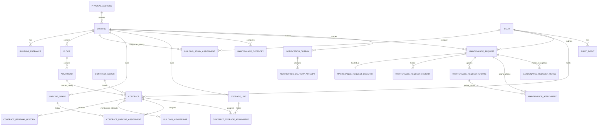

# BlueSky — MVP1 Entity Relationship Model

**Version:** 1.1  
**Status:** Logical data model; physical PostgreSQL design baseline  
**Date:** 2026-11-21

## 1. Purpose and design principles

This document translates the approved MVP1 business rules into a logical relational model. It is the basis for the later PostgreSQL migration design; it is not itself a migration.

Design principles:
- Preserve business history rather than overwriting or deleting it.
- Enforce tenant/building isolation in backend authorization and with relational constraints where practical.
- Use PostgreSQL transactions for multi-record business operations.
- Keep resident-visible maintenance history separate from administrative audit history.
- Use an Outbox pattern for reliable asynchronous email delivery.
- Store photo binaries in private object storage; PostgreSQL stores metadata and ownership.
- Do not introduce chat, general messaging, configurable notification preferences, or microservices.

## 2. Core entity groups

### 2.1 Identity, building, and physical structure

| Entity | Purpose | Important attributes |
|---|---|---|
| users | Account identity | id, email, email_verified_at, status, created_at |
| physical_addresses | Physical street address | id, address fields |
| buildings | Managed building | id, physical_address_id, building_plate_number, name, status, timezone |
| building_entrances | Entrances belonging to one building | id, building_id, name, portal_access_code_secret_reference |
| building_admin_assignments | Current and historical administrator assignment | id, building_id, user_id, effective_from, effective_to |
| floors | Floors within a building | id, building_id, floor_label |
| apartments | Apartments on a floor | id, floor_id, apartment_number, status |

A physical address may contain multiple buildings. A building belongs to exactly one physical address. Building plate number is unique within the physical address, not globally. Each building may have multiple entrances. Portal access codes are secrets: store using an appropriate secret-protection mechanism, restrict access, audit changes, and never include them in ordinary resident API responses.

Floor label and apartment-number formats remain implementation decisions. Do not infer that apartments are associated with entrances; that relationship has not been approved.

### 2.2 Contracts, memberships, and assets

| Entity | Purpose | Important attributes |
|---|---|---|
| contract_issuers | Scope for externally issued Contract IDs | id, name |
| contracts | Contract for exactly one apartment and one holder | id, issuer_id, contract_id, apartment_id, holder_user_id, valid_from, valid_to, status, created_at |
| contract_renewal_history | Immutable renewal record | id, contract_id, previous_valid_to, new_valid_to, renewed_at, renewed_by_user_id |
| building_memberships | Membership request and historical access decision | id, user_id, building_id, contract_id, status, submitted_at, reviewed_at, reviewed_by_user_id, rejection_reason |
| parking_spaces | Independent parking assets | id, building_id, asset_code, status |
| storage_units | Independent storage assets | id, building_id, asset_code, status |
| contract_parking_assignments | Historical contract-to-parking assignments | id, contract_id, parking_space_id, valid_from, valid_to |
| contract_storage_assignments | Historical contract-to-storage assignments | id, contract_id, storage_unit_id, valid_from, valid_to |

Rules:
- Contract ID uniqueness is scoped to contract issuer; IDs are never reused.
- Each contract has exactly one holder and one apartment. A user may hold multiple contracts.
- Contract states are Scheduled, Active, Expired, and Revoked. Renewal is an operation recorded in contract_renewal_history, not a status.
- Contract effective periods for the same apartment must not overlap. Use half-open intervals [valid_from, valid_to) and a transaction-safe PostgreSQL exclusion constraint or equivalent robust enforcement; do not rely only on a status-based partial unique index.
- A Scheduled contract grants no access before valid_from. Expired or Revoked contracts grant no access.
- A contract may have multiple parking and storage assignments. Each parking space and storage unit may have at most one active assignment at a time. Assigned assets must belong to the same building as the contract apartment.
- Asset assignment changes close the prior row and create a new row; preserve history.
- A contract may have at most one Approved membership at a time. Preserve Pending, Rejected, and Revoked attempts. Enforce concurrent approval safely.

### 2.3 Maintenance

| Entity | Purpose | Important attributes |
|---|---|---|
| maintenance_categories | Building-specific configurable categories | id, building_id, name, description, is_enabled, sort_order |
| maintenance_requests | Original request and current workflow state | id, building_id, submitted_by_user_id, category_id, description, status, priority, submitted_at, resolution_description, resolved_by_user_id, resolved_at, rejection_reason, rejected_by_user_id, rejected_at |
| maintenance_request_locations | Exactly one controlled problem location per request | id, maintenance_request_id, location_type, common_area_type, apartment_id |
| maintenance_request_history | Resident-visible chronological workflow history | id, maintenance_request_id, actor_user_id, action_type, old_status, new_status, old_priority, new_priority, note, created_at |
| maintenance_request_updates | Append-only supplementary comments/photos | id, maintenance_request_id, author_user_id, update_type, comment_text, created_at |
| maintenance_attachments | Photo metadata and original ownership context | id, maintenance_request_id (nullable), maintenance_request_update_id (nullable), storage_key, file_name, content_type, size_bytes, uploaded_by_user_id, created_at |
| maintenance_request_merges | Duplicate-to-master relationship | id, master_request_id, duplicate_request_id, merged_by_user_id, merged_at |

Location model:
- location_type is PrivateArea or CommonArea.
- PrivateArea requires apartment_id and requires common_area_type to be null.
- CommonArea requires common_area_type and requires apartment_id to be null.
- Common-area types: FloorCorridor, Elevator, Staircase, Parking, BuildingExterior, OtherCommonArea.
- A private-area apartment must belong to the request's building. The resident must hold an eligible contract for that apartment when submitting.
- Each request has exactly one location row. Create request and location atomically.

Priority:
- Low, Normal, High, Urgent; priority is initially null.
- Only the Building Administrator assigns or changes priority.
- Urgent is reserved exclusively for an immediate safety risk.
- Every priority change creates a history row and an audit event.

Workflow:
- Statuses: Submitted, UnderReview, Approved, InProgress, Resolved, Rejected, Merged.
- Resolved, Rejected, and Merged are terminal.
- Residents and administrators cannot add ordinary updates to terminal requests.
- Residents cannot cancel requests. Resolved requests cannot be reopened.
- Resolution requires resolution_description, resolved_by_user_id, and resolved_at. Resolution photos are optional.
- Rejection requires rejection_reason, rejected_by_user_id, and rejected_at.
- A duplicate can be merged only from Submitted, UnderReview, Approved, or InProgress. Master request retains its own status and history. A merge cannot create cycles.
- Resident-visible request history and supplementary updates are append-only. There are no internal notes and no private conversation threads.
- Residents can add a comment, photos, or both to eligible requests. Administrators can do the same for requests in their building. Each update allows at most five photos; original submission also allows at most five. Each photo is at most 10 MB and must be JPEG, PNG, or WebP. No cumulative request photo cap is imposed.
- Original submission content is immutable; supplementary updates are separate records.

Privacy and duplicate merging:
- A resident linked to a master request through a duplicate merge can see the master request's resident-visible description, attachments, status, priority, history, updates, and resolution.
- Master submitter identity/contact details remain private.
- Duplicate request descriptions, attachments, and updates remain private to their respective submitters and authorized administrators.
- Audit records and security metadata are never resident-visible.
- Attachment authorization must use original ownership context and merge-sharing rules; never infer access from a request ID alone.

### 2.4 Notifications and audit

| Entity | Purpose | Important attributes |
|---|---|---|
| notification_outbox | Durable notification event and current delivery state | id, event_type, building_id, aggregate_type, aggregate_id, recipient_user_id, payload, status, attempt_count, retry_cycle, next_attempt_at, created_at, processed_at, skip_reason |
| notification_delivery_attempts | Immutable record of each provider attempt | id, notification_outbox_id, retry_cycle, attempt_number, recipient_email, started_at, completed_at, outcome, provider_message_id, error_message, initiated_by_user_id |
| audit_events | Security and administrative audit trail | id, actor_user_id, building_id, entity_type, entity_id, action, occurred_at, before_after_data |

Notification design:
- Email is the MVP1 notification channel. In-app maintenance request history is authoritative; there is no separate general messaging or notification-preference system.
- Events include request submitted, approved, rejected, priority changed, work started, merged, and resolved. A new Urgent request or a change to Urgent sends an immediate email to the Building Administrator only. Residents receive no additional Urgent email.
- Contract lifecycle emails include the approved 60-day expiration reminder, expiration confirmation, early revocation, and successful renewal notices.
- The Outbox payload is minimal: event ID/type, building ID, aggregate/request ID, recipient user ID, and event creation timestamp. Do not store rendered email bodies or unnecessary personal data in the payload.
- The worker loads current recipient data at processing time, verifies account status and eligibility, then captures the current email address for that attempt. An in-progress attempt is not interrupted by a later email change; a later retry loads the latest address.
- If the recipient is no longer eligible, mark delivery Skipped with a reason and timestamp. Skipped deliveries are not automatically retried.
- Save the business change and Outbox event in the same PostgreSQL transaction. Email sending occurs asynchronously after commit. Email failure never rolls back the business action.
- Automatic retry policy: five attempts total, with delays of 1, 5, 15, and 60 minutes after failures. After five failed attempts, status is Failed.
- Building Administrator may manually retry Failed notifications for their own building. Preserve previous attempts; manual retry starts a new retry cycle and is audited. Do not reset original event creation time or retention.
- Monitoring is available only to the Building Administrator of the associated building. It shows notification ID, event type, related request, recipient email, status, attempt count, last attempt, and last error, with detail/attempt views and manual retry for Failed records.
- Retain Outbox events and delivery attempts for 24 months from original event creation. Manual retry does not reset retention.
- Delivery attempts record the recipient email captured at the start of that attempt, outcome, timestamps, and provider error/reference where available.

Administrative audit events are separate from resident-visible maintenance_request_history. Never expose audit_events or notification delivery internals through resident APIs.

## 3. PostgreSQL implementation constraints

Implement important invariants in PostgreSQL as well as application services where practical:

1. Foreign keys must prevent cross-building relationships. For example, use composite unique keys and composite foreign keys where needed to guarantee that a request category, apartment, or asset belongs to the same building as its parent operation.
2. Use CHECK constraints for location field combinations, allowed enum/status values where appropriate, nonnegative sizes/attempt counts, and required resolution/rejection fields for terminal states.
3. Use a unique constraint on maintenance_request_locations.maintenance_request_id to enforce one location row per request.
4. Use a CHECK constraint on maintenance_attachments so exactly one of maintenance_request_id and maintenance_request_update_id is populated.
5. Use indexes for building-scoped request queues, request chronology, pending Outbox polling, and notification monitoring.
6. Use transaction-safe constraints/locking for contract non-overlap, one Approved membership per contract, and exclusive asset assignments.
7. Use unique/idempotency keys for Outbox event creation and delivery processing so retries do not create duplicate business notifications.
8. Use TIMESTAMPTZ for instants. Contract date boundaries must be evaluated in the building's configured timezone; a contract remains valid through its expiration date and becomes ineligible at the following local midnight.
9. Keep storage keys private; authorize every upload and download. Validate actual file content, not only extension or declared MIME type.
10. Preserve historical rows; use status/validity closure rather than destructive deletion for business records.

## 4. Mermaid relationship overview

## 5. Deliberately deferred physical details

The following do not block the logical model and should be resolved during implementation without expanding MVP1:
- Exact floor-label and apartment-number formats.
- Apartment-to-entrance relationship.
- Final authentication provider and email provider.
- Exact production object-storage provider.
- Exact audit-event retention period and legal deletion policy.
- Final PostgreSQL enum-versus-lookup-table convention.
- Final index names and migration ordering.

Do not add chat, internal notes, resident-configurable notification preferences, general announcements, or a separate notification inbox to MVP1.

## 6. Related documentation

- [MVP1 Scope](mvp1-scope.md)
- [Feature Catalogue](feature-catalogue.md)
- [Business Rules](business-rules.md)
- [Architecture](architecture.md)
