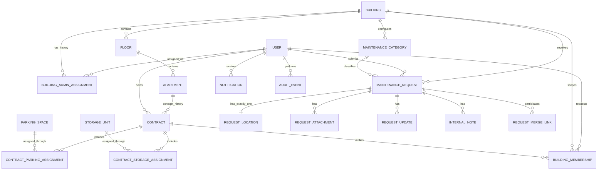

# BlueSky — MVP1 Entity Relationship Diagram

**Version:** 1.0  
**Status:** Conceptual data model  
**Date:** 2026-11-18

## 1. Purpose

This document defines the initial conceptual and logical database entities for MVP1.

It is not a finalized PostgreSQL schema or migration script.

The model must preserve confirmed business rules and explicitly identify unresolved relationships.

## 2. Confirmed cardinality rules

1. Each Contract belongs to exactly one Apartment.
2. An Apartment may have multiple historical contracts.
3. An Apartment may have only one active Contract at a time.
4. A Contract may have zero or multiple ParkingSpace assignments.
5. A Contract may have zero or multiple StorageUnit assignments.
6. Parking and storage are independent assets.
7. Each Building has exactly one Building Administrator in MVP1.
8. Each Contract has exactly one contract holder.

## 3. Entity relationship diagram

The diagram uses Mermaid ER notation. User-to-Contract cardinality remains
provisional because the decision on whether one user may hold multiple
contracts has not yet been finalized.



The diagram is conceptual. The physical schema may require additional reference entities, indexes, and constraints.

## 4. Candidate entities

### 4.1 Identity and building

| Entity | Purpose | Example attributes |
|---|---|---|
| User | User account and identity | Id, Email, EmailVerifiedAt, Status, CreatedAt |
| Building | Residential building | Id, Name, Address, Country, Status |
| BuildingAdminAssignment | Administrator assignment | Id, BuildingId, UserId, EffectiveFrom, EffectiveTo |
| Floor | Building floor | Id, BuildingId, FloorNumber, DisplayName |
| Apartment | Apartment on a floor | Id, FloorId, ApartmentNumber, Status |

Platform Administrator can be implemented as a platform-level role rather than a separate database entity.

### 4.2 Contracts and assets

| Entity | Purpose | Example attributes |
|---|---|---|
| Contract | Contract for one apartment and one holder | Id, ContractId, ApartmentId, HolderUserId, ValidFrom, ValidTo, Status |
| ParkingSpace | Independent parking asset | Id, BuildingId, AssetCode, Status |
| StorageUnit | Independent storage asset | Id, BuildingId, AssetCode, Status |
| ContractParkingAssignment | Contract-to-parking relationship | Id, ContractId, ParkingSpaceId, ValidFrom, ValidTo |
| ContractStorageAssignment | Contract-to-storage relationship | Id, ContractId, StorageUnitId, ValidFrom, ValidTo |

The Contract ID must be unique within its issuing management
company's scope and must never be reused.

The issuing management company must be represented in the data model
if multiple issuers can use overlapping Contract IDs.

The uniqueness constraint must cover the combination of issuer
and Contract ID, unless global uniqueness is explicitly adopted.

**Open:** Whether a User may hold multiple contracts.

**Open:** Whether one parking space or storage unit may be assigned to multiple active contracts at the same time.

Do not implement an exclusive asset-assignment constraint until the latter rule is decided.

### 4.3 Membership

| Entity | Purpose | Example attributes |
|---|---|---|
| BuildingMembership | Resident membership request and access | Id, UserId, BuildingId, ContractId, Status, SubmittedAt, ReviewedAt, ReviewedByUserId, RejectionReason |

Membership is separate from the User account.

A registered user can exist without approved building membership.

A membership must reference a contract associated with an apartment in the selected building.

### 4.4 Maintenance

| Entity | Purpose | Example attributes |
|---|---|---|
| MaintenanceCategory | Building-specific category | Id, BuildingId, Name, Description, IsEnabled, SortOrder |
| MaintenanceRequest | Resident's maintenance report | Id, BuildingId, SubmittedByUserId, CategoryId, Status, Priority, Description, SubmittedAt |
| RequestLocation | Problem location | Id, RequestId, LocationType, FloorId, ApartmentId, Details |
| RequestAttachment | Photo metadata | Id, RequestId, RequestUpdateId, StorageKey, FileName, ContentType, SizeBytes, UploadedByUserId, CreatedAt |
Every attachment must belong to exactly one owning submission context:
either the original MaintenanceRequest or one RequestUpdate.

The data model must prevent an attachment from belonging to both
contexts or neither context.

The original ownership relationship must be preserved after request
merging.

Attachment authorization must use the original ownership context
and the applicable master-request sharing rules.

| RequestUpdate | Supplementary request update | Id, RequestId, AuthorUserId, Body, CreatedAt |
| InternalNote | Administrator-only note | Id, RequestId, AuthorUserId, Body, CreatedAt |
| RequestMergeLink | Duplicate-to-master relationship | Id, MasterRequestId, DuplicateRequestId, MergedByUserId, MergedAt |
| Notification | Notification record | Id, RecipientUserId, RequestId, Type, CreatedAt, ReadAt, DeliveryStatus |
| AuditEvent | Business action history | Id, ActorUserId, BuildingId, EntityType, EntityId, Action, OccurredAt, Data |

The attachment model must preserve the original report association after a merge.

### Shared master-request access

- Residents linked to a master request through duplicate merging can access
  all resident-visible details of that master request.
- Shared details include the master description, master attachments,
  status, priority, shared updates, and resolution details.
- Master submitter identity and contact information must remain private.
- Duplicate request descriptions, attachments, and updates remain private
  to their respective submitters and authorized administrators.
- Internal notes, audit records, and security metadata remain administrator-only.
- Backend authorization must determine whether a resident is linked to
  the master request before returning shared details or attachments.

  
## 5. Important database constraints

### Contract and apartment

- Contract.ApartmentId is mandatory.
- Enforce at most one active contract per ApartmentId.
- Preserve expired and revoked contract records.
- Contract ID must be unique and never reused.
- Expired or revoked contracts cannot authorize new membership.

A PostgreSQL partial unique index is one possible implementation:

```sql
CREATE UNIQUE INDEX ux_contract_one_active_per_apartment
ON contracts (apartment_id)
WHERE status = 'Active';
```

This example assumes the final schema uses a status column with the value `Active`. The migration must match the implemented status model and have an integration test.

### Building Administrator assignment

- Each provisioned building must have exactly one active Building Administrator.
- Administrator assignment history must be preserved.
- Every assignment must record EffectiveFrom and EffectiveTo.
- The active assignment has no EffectiveTo value.
- Assignment periods for the same building must not overlap.
- Replacing an administrator must close the previous assignment and create
  the new assignment in one database transaction.
- MVP1 does not support multiple active administrators, delegation,
  or temporary overlapping assignments.

The ERD relationship represents assignment history. The database must
enforce exactly one active assignment per provisioned building and
prevent overlapping effective periods. These are separate constraints;
the one-to-many history relationship does not permit multiple active
assignments.

### Membership

- Membership references one User, one Building, and one Contract.
- Contract must resolve to an apartment in the same Building.
- Only the authorized Building Administrator can approve or reject.
- Duplicate active memberships must be prevented according to the final membership lifecycle rules.
### Membership uniqueness

- Multiple historical membership records may reference the same Contract.
- A Contract may have at most one Approved membership at a time.
- Rejected and Revoked records must be preserved.
- A new membership may be approved after the previous Approved membership
  has been revoked, provided the Contract remains eligible.
- The system must prevent concurrent approval of multiple memberships
  for the same Contract.
- The database must enforce the one-Approved-membership-per-Contract
  invariant using an appropriate unique constraint or partial unique index.


### Maintenance privacy

- Every maintenance request belongs to one Building.
- Every maintenance request has exactly one RequestLocation record.
- RequestLocation must reference exactly one request; RequestId must be unique.
- Request creation and RequestLocation creation must commit atomically.
- Residents can access their own private requests.
- InternalNote must never appear in resident-facing API projections.
- Every attachment retrieval must perform authorization checks.
- A request cannot be merged with itself.
- Circular merge relationships must be prevented.
- Original request IDs and histories must be preserved.

## 6. Request lifecycle

Current status vocabulary:

- Submitted
- Under Review
- Approved
- In Progress
- Resolved
- Rejected
- Merged

Exact allowed transitions, cancellation, and reopening behavior remain open.

Status changes should be handled by explicit application/domain operations rather than arbitrary client updates.

## 7. Duplicate merge transaction

A merge should be atomic:

1. Verify both requests belong to the same building.
2. Verify the actor is the authorized Building Administrator.
3. Verify the merge does not create a cycle.
4. Select the master request.
5. Create the merge relationship.
6. Mark the duplicate request as Merged.
7. Preserve original request details and attachments.
8. Record audit events.
9. Generate privacy-safe notifications for affected residents.

## 8. Data retention

Preserve:
- Historical contracts.
- Original request identities.
- Request histories.
- Asset assignment history.
- Audit events according to the final retention policy.

Exact retention periods and applicable legal deletion requirements are open.

Prefer archival or status changes over destructive deletion when historical activity references a record.

## 9. Physical schema decisions still open

1. Can one User hold multiple Contracts?
2. Can parking and storage assets have overlapping active assignments?
3. Should Contract holder be stored directly on Contract or through a separate party relationship?
4. What are the exact Contract and Membership status transitions?
5. Should RequestLocation use nullable foreign keys or a location subtype model?
6. How should notification delivery attempts be tracked?
7. What is the audit event payload format?
8. Does shared maintenance progress require a separate entity from private RequestUpdate?

Resolve these questions before finalizing the relevant migrations. Do not over-engineer the schema to anticipate unapproved features.

## 10. Related documentation

- [MVP1 Scope](mvp1-scope.md)
- [Feature Catalogue](feature-catalogue.md)
- [Business Rules](business-rules.md)
- [Architecture](architecture.md)
